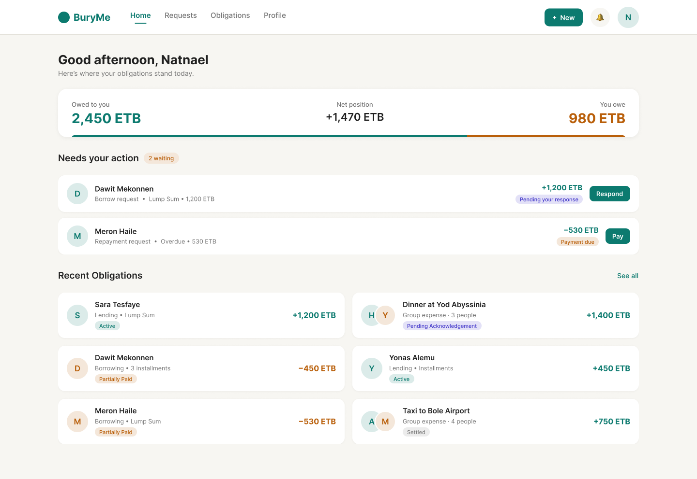
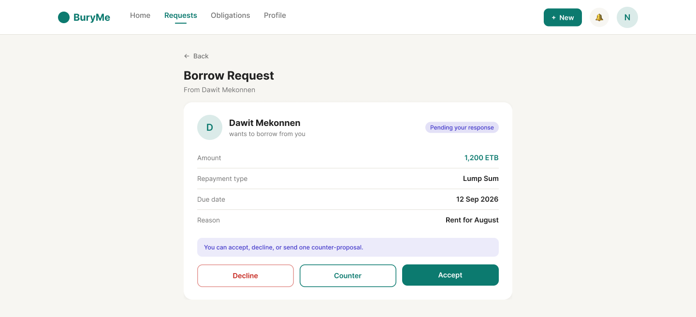
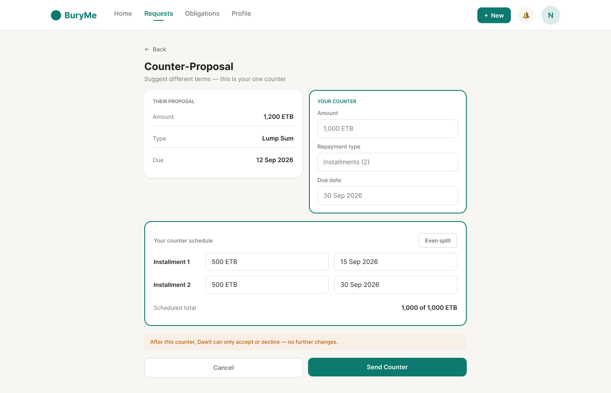
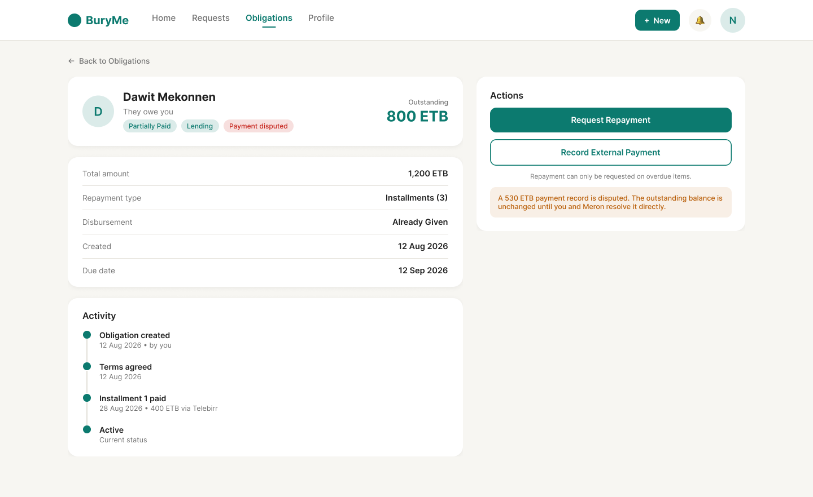
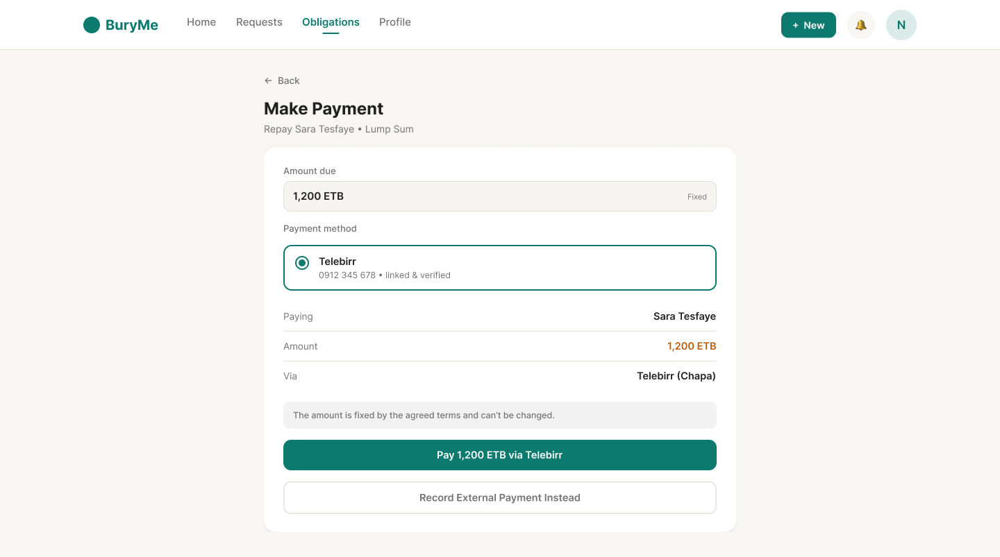
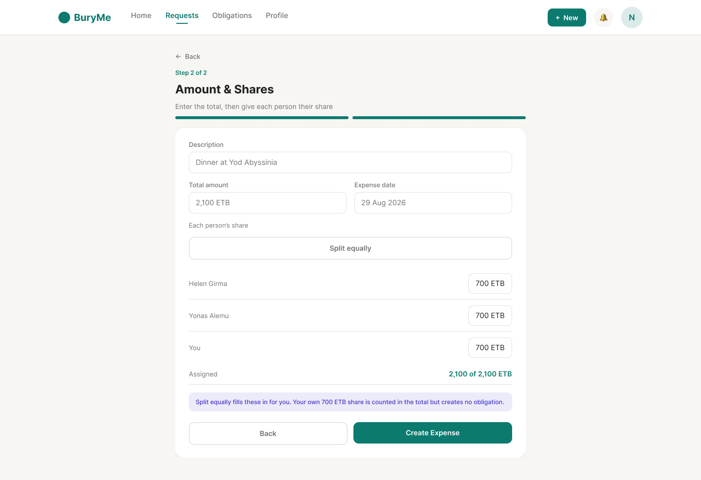
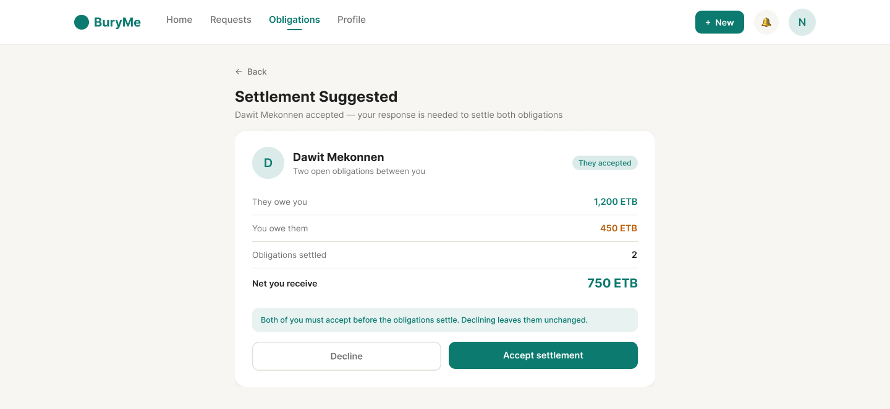

# BuryMe

A peer-to-peer IOU / micro-lending tracker for Ethiopia (PRD v2.7). Two
people agree terms for a loan — borrow or lend, lump sum or installments —
and the platform tracks the resulting obligation through disbursement,
repayment and settlement. It also handles group expenses (one payer, N
participants, a bilateral obligation per share) and two-party net
settlement, where mutual debts are cleared with a single payment.

Money is always ETB. Payments run through Chapa (Telebirr for MVP), auth
through Firebase, and notifications through Socket.io plus FCM.

Web-first; mobile (Flutter) follows once the web + backend surface is
stable.



## Screens

One obligation, from proposal to settled.

|                                                                                                                                                                |                                                                                                                                                    |
| -------------------------------------------------------------------------------------------------------------------------------------------------------------- | -------------------------------------------------------------------------------------------------------------------------------------------------- |
| <br>**Agree.** The other side accepts, declines, or counters once.         | <br>**Negotiate.** One counter, then the terms are fixed.               |
| <br>**Track.** Outstanding balance, agreed terms, and an append-only activity log. | <br>**Settle.** Pay through Telebirr via Chapa, or record a cash payment.            |
| <br>**Split.** One bill becomes a bilateral obligation per participant. | <br>**Net off.** Mutual debts clear with a single payment. |

These files live under `web/src/assets/landing/` rather than in a docs folder
because the landing page at `/welcome` renders the same images — one copy, one
place to update.

## Stack

|           |                                                                 |
| --------- | --------------------------------------------------------------- |
| Backend   | Express 4, Prisma 7, PostgreSQL 16, Socket.io, Zod              |
| Web       | React 18, Vite 5, TanStack Query 5, CSS Modules                 |
| Auth      | Firebase (client SDK for OTP, Admin SDK for verification)       |
| Payments  | Chapa — Telebirr only, modelled as two hops (collect, transfer) |
| Messaging | FCM for push, AfroMessage for Telebirr OTP SMS                  |
| Tooling   | pnpm workspaces, TypeScript strict, Vitest, ESLint, Prettier    |

## Structure

```
/backend    Express/Node API — all business logic lives here
/web        React web client — thin, consumes the API only
            (public landing page at /welcome; everything else needs auth)
/shared     Generated TypeScript types from contract/openapi.yaml
/contract   openapi.yaml — the source of truth for the API surface
```

See [`CLAUDE.md`](./CLAUDE.md) for architecture decisions, the development
approach, and the build plan — read that first before writing code. See
[`DEPLOY.md`](./DEPLOY.md) for deploying, including what is deliberately not
yet hardened for real money.

## Getting started

```bash
cp .env.example .env    # do this FIRST — see note below
pnpm install
pnpm db:up              # local Postgres via Docker Compose, on host port 5433
pnpm db:migrate:deploy  # apply migrations; a fresh database has no tables
pnpm dev:backend        # http://localhost:4000
pnpm dev:web            # http://localhost:5173
```

Copy `.env` **before** installing: the backend's `postinstall` runs
`prisma generate`, which needs `DATABASE_URL` to be present (it does not
need the database to be reachable). The file lives at the repo root, not in
`backend/` — `prisma.config.ts` and both dev scripts load it from there.

Two things the backend refuses to start without:

- **The three `FIREBASE_*` values.** `config/env.ts` requires them at import.
- **Chapa credentials, or `CHAPA_FAKE=1`.** `.env.example` ships
  `CHAPA_FAKE=1`, which selects a keyless double that fabricates successful
  transfers so the whole disbursement flow works offline. It also accepts
  _every_ webhook signature, which is why it has to be asked for explicitly
  and must never be set in a deployed environment.

`AFROMESSAGE_API_KEY` left blank is fine and is the normal local setup:
Telebirr OTP codes are logged to the backend console instead of being sent
as SMS.

## Everyday commands

```bash
pnpm -r run typecheck               # all three packages
pnpm lint                           # ESLint
pnpm format                         # Prettier, write
pnpm format:check                   # Prettier, verify
pnpm build                          # build every package
pnpm test                           # Vitest, every package
```

## Working with the contract

`contract/openapi.yaml` is the source of truth for the API. Code conforms to
it, not the other way around. After editing it:

```bash
pnpm types:generate                 # regenerate shared/src/api-types.gen.ts
pnpm --filter @buryme/shared build  # ...then rebuild, or the web won't typecheck
```

The second step is easy to forget and the failure is confusing. `/web` and
`/backend` reference `/shared` as a composite TypeScript project, so they
typecheck against its **built** declarations in `shared/dist` — a stale or
missing build surfaces as dozens of `implicitly has an 'any' type` errors in
the web app, not as an error about `shared`.

Two more things that bite:

- **Never hand-edit `shared/src/api-types.gen.ts`.** Change the contract and
  regenerate.
- **`pnpm format` reformats `openapi.yaml`**, which changes the generated
  output. Re-run `types:generate` after formatting and confirm it's
  idempotent.

Generated types are committed, and CI checks they match the contract.

## Database

Migrations live in `backend/prisma/migrations` and are applied with
`pnpm db:migrate:deploy`. Other helpers: `pnpm db:studio`, `pnpm db:reset`,
`pnpm db:generate`, `pnpm db:down`.

To check the schema and the database agree:

```bash
cd backend
npx prisma migrate diff --from-config-datasource \
  --to-schema prisma/schema.prisma --script
```

`-- This is an empty migration.` means no drift.

**`prisma migrate dev` refuses to run non-interactively**, which blocks it in
most automated or agent-driven shells. To create a migration there, generate
the SQL with the `migrate diff` command above, save it as
`backend/prisma/migrations/<timestamp>_<name>/migration.sql`, then run
`pnpm db:migrate:deploy`.

Note that `prisma/schema.prisma` deliberately lags the contract: models are
added one slice at a time, as CLAUDE.md describes. The header comment in that
file records how far it is scoped.

## Current state

All nine slices in CLAUDE.md are implemented end to end — auth, users,
requests and negotiation, disbursement, payments, schedules, group expenses,
settlements, and notifications (feed, real-time, push, and the §13.3 reminder
scheduler) — plus the obligation history endpoint and the marketing landing
page. 171 backend tests and 37 web tests.

Not done yet:

- Chapa has never run against the live API. Going live needs a public webhook
  URL (`API_PUBLIC_ORIGIN`), and the `bank_code`, signature header and payload
  field names confirmed against the real service.
- Nine notification events in the §13.2 catalog aren't emitted because the
  features behind them don't exist. The `NotificationType` enum in the
  contract names each one and why.
- Telebirr ownership isn't really verified — Chapa doesn't check it, so OTP
  verification was added separately.

## Known rough edges

- **FCM push is inert on the web client** — nothing registers a token and
  there is no service worker. The Socket.io layer covers real-time on web;
  push matters for the Flutter app.
- **Web test coverage is narrow.** The 37 web tests cover `web/src/lib/`, the
  pure formatting and display-gating helpers. Components and hooks are
  untested; the backend suite carries the behaviour.
- **The landing page's small-screen layout is derived, not designed.** The
  Figma frame is desktop-only (1440), so the breakpoints below it are a
  judgement call and worth a look before launch.
